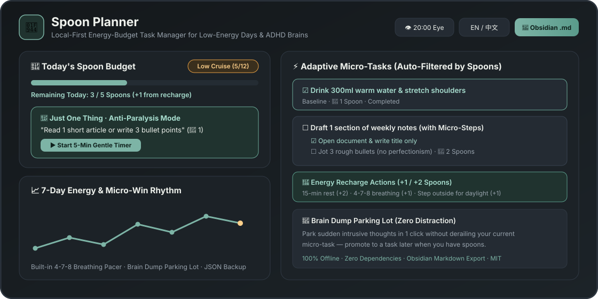

<div align="center">

# 🥄 Spoon Planner

**A Local-First Energy-Budget (Spoon Theory) Task Manager for Low-Energy Days & ADHD Brains**

*No guilt. No cloud accounts. Rate your real energy (1–12 spoons), auto-hide overwhelming tasks, beat paralysis with a 5-minute gentle starter, and export directly to Obsidian.*

[简体中文](./README_CN.md) · [Live Demo](https://zhonglongluo.github.io/spoon-planner/) · [Features](#-features) · [Quick Start](#-quick-start) · [Contributing](./CONTRIBUTING.md)


<br/>



</div>

---

## 💡 Why Spoon Planner?

Traditional to-do apps punish you for being human — overdue badges turn red, long lists trigger **ADHD task paralysis**, and high-energy days trick you into burning tomorrow's energy.

**Spoon Planner** is built around **Spoon Theory** and **low-friction pacing**:
- You budget **energy (spoons)**, not just clock hours.
- On low-spoon days, heavy tasks vanish automatically so you only see 1–2 realistic baseline wins.
- Every piece of data lives 100% locally in your browser with instant **Obsidian Markdown** and **JSON** export.

---

## ✨ Features

1. **🥄 Dynamic Spoon Budget (1–12 Spoons) & Recharge Actions**
   - 4 adaptive modes: **Survival (1–3)**, **Low Cruise (4–6)**, **Steady Flow (7–9)**, and **High Energy with 80% Buffer Rule (10–12)**.
   - Completing tasks spends spoons; checking off **Recharge Actions** (+1/+2 spoons like a 15-min rest, daylight walk, or breathing) restores your meter.
2. **🎯 Anti-Paralysis "Just One Thing" + 5-Minute Gentle Starter**
   - Click **"Pick lightest task"** to collapse decision fatigue down to one doable item.
   - Start a **5-minute timer** with explicit permission to stop once the 5 minutes are up.
3. **🪜 Inline Micro-Step Breaker & 🧠 Brain Dump Parking Lot**
   - Break intimidating tasks into tiny 2-minute sub-steps directly inline.
   - Park stray intrusive thoughts in the **Brain Dump** without derailing your focus, and promote them into tasks later in 1 click.
4. **🫧 Built-in Regulation & Rhythm Tools**
   - **4-7-8 Breathing Pacer** + **20-20-20 Eye-Care Timer** + **7-Day Energy SVG Sparkline**.
   - **Obsidian `.md` Export** (YAML frontmatter) + **JSON Backup/Restore** ([JSON Schema](./schema/state.schema.json)).
   - Bilingual (**EN / 中文**) + **Warm Dark / Warm Paper** eye-friendly themes.

---

## 🚀 Quick Start

```bash
git clone https://github.com/zhonglongluo/spoon-planner.git
cd spoon-planner
open index.html   # works 100% offline with zero build step
```

Or open the hosted static app directly: **https://zhonglongluo.github.io/spoon-planner/**

---

## 🔗 More Local-First Tools
- 🚦 **[Med × Alcohol Guard](https://github.com/zhonglongluo/med-alcohol-guard)** — Offline medication × alcohol interaction traffic-light checker & multi-drink BAC estimator.

## 📄 License
[MIT](./LICENSE)
