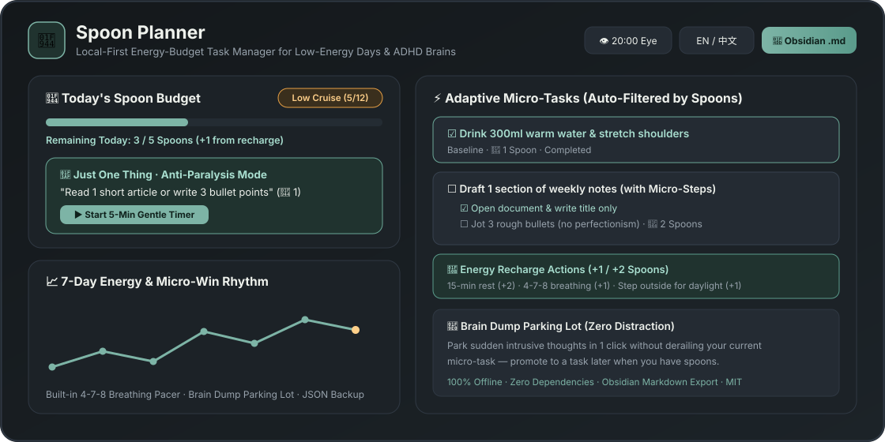

<div align="center">

# 🛡️ Low-Energy-Guard（低精力状态守护工具）

> **Low-Energy-Guard 不是效率工具，而是你的低精力状态守护工具。它帮助你在低谷时保持节奏、减少内耗，先稳住睡眠和身体，再谈成长。**

*面向低精力、高敏感、易内耗人群 · 100% 本地优先 · 零依赖 · 零云端上传*

[English README](./README.md) · [在线免安装体验](https://zhonglongluo.github.io/low-energy-guard/) · [核心模块](#-五大核心模块) · [快速启动](#-快速启动)

<br/>



</div>

---

## 🌱 设计理念

**睡眠、环境、性格、身体，才是人生最重要的底盘。**

市面上大多数效率工具都在推崇高强度自律，但在低精力、高敏感或情绪低谷时，长待办和打卡惩罚只会放大内耗。**Low-Energy-Guard** 先看你的睡眠、精力和情绪反刍状态，再帮你稳住节奏——**先照顾好底盘，再谈成长**。

---

## 🧩 五大核心模块

### 1. 🥄 相对精力管理（自定义基线 × 睡眠反向修正）
- **相对值模式**：不设统一满分，支持自定义你的“个人满格精力基线”（`5–15`）；
- **睡眠反向修正系数**：昨晚睡得不好或时长不足时，系统自动乘以修正系数（`×0.60` / `×0.75` / `×0.90`）**动态下调今日精力上限**，避免硬撑透支；
- **纯分级任务与 2 次点击极速记录**：任务只做 **低耗 / 中耗 / 高耗** 分级，主屏支持 **2 次点击完成状态记录**；没有打卡、没有连续天数、没有成就系统。

### 2. 🌙 睡眠与休息守护
- 记录入睡时间、起床时间（自动跨午夜计算睡眠小时）、睡眠质量（`1–5`）与午休补觉；
- 作为**整体状态判断的核心指标**，睡不够时自动触发「透支保护提醒」并联动调低今日节奏；
- 内置 **近 7 天「睡眠时长 × 精力勺数」双底盘节律图**。

### 3. 🫧 情绪与反刍记录
- 一键记录此刻情绪状态；
- 快速标记是否陷入 **「反复复盘过去 / 过度担忧未来 / 自我攻击苛责 / 休息时愧疚」** 等内耗循环；
- 给出温和不居高临下的暂停建议，并配有 **4-7-8 舒缓呼吸节拍器** 与一句话速记。

### 4. 📝 Obsidian 导出与本地档案
- 实时生成带标准 **YAML Frontmatter** 的 Obsidian 每日健康档案，支持 **一键复制、下载今日 `.md`、导出近 7 天周报 `.md`**；
- 全部数据仅存在本机浏览器 `localStorage`，支持 **JSON 全量备份/恢复**（附 [state.schema.json](./schema/state.schema.json)），完全不依赖云端。

### 5. 🧭 低能耗建议引擎
- **不输出鸡血励志**，拒绝焦虑红点；
- 实时综合 **睡眠 + 精力勺数 + 情绪反刍** 三大信号，给出务实温和的低能耗建议（例如：“今天精力低，优先只做一件小事，今晚提前休息”），明确列出「今天可以轻做」与「今天允许放过」。

---

## 🚀 快速启动

```bash
git clone https://github.com/zhonglongluo/low-energy-guard.git
cd low-energy-guard
open index.html   # 零构建、完全离线可用
```

或直接使用在线静态版：**https://zhonglongluo.github.io/low-energy-guard/**

---

## 🔗 更多 Local-First 开源工具
- 🚦 **[Med × Alcohol Guard](https://github.com/zhonglongluo/med-alcohol-guard)** — 离线药物×酒精禁忌红绿灯速查与多杯代谢估算器。

## 📄 License
[MIT](./LICENSE)
